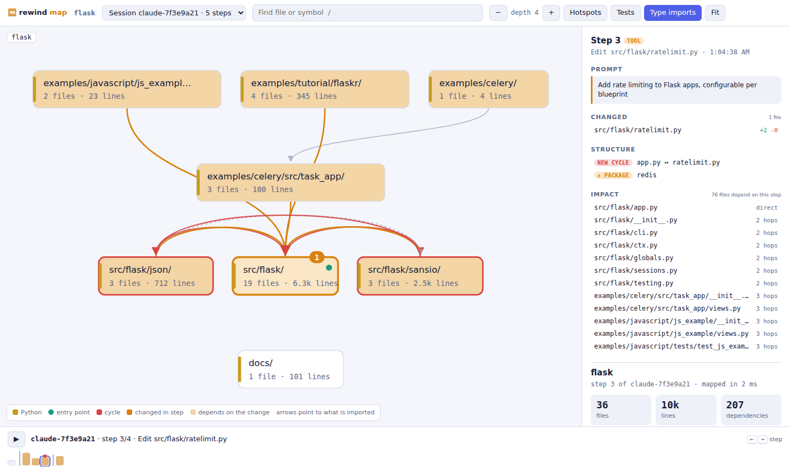

# cool_projects404

Things I build to sharpen my skills and make my own work easier.

| Project | What it is | Stack |
|---|---|---|
| [⏪ Rewind](rewind/) | Undo history and a code map for AI coding agents: every agent step saved as a Git snapshot you can restore, `rewind bisect` to find the step that broke the tests, an interactive map that replays what the agent changed, and an MCP server so agents can use it themselves | Go, Git internals, static analysis, MCP |
| [🍅 Tomato Dial](tomato-dial/) | A focus timer you set by dragging a kitchen-timer dial, with tasks, ambient sounds and stats | HTML, CSS, JS, Web Audio |
| [💿 Spin Room](spin-room/) | A record player and CD player that spin to your beats, made to screen-record for TikTok | HTML, CSS, JS, Web Audio |

## ⏪ Rewind — [`rewind/`](rewind/)

When an AI agent breaks something at step 14 of 30, `rewind restore 13` gets you back, without losing steps 1–12 or touching your branch. Each step is stored as a real Git commit under `refs/rewind/`, tagged with the prompt that caused it. Install the hooks with `rewind init claude` (or `codex`, `gemini`, `cursor`).

When the tests fail, `rewind bisect -- npm test` binary-searches the agent's steps and names the one that broke them, with its prompt and diff. `rewind undo <step>` then takes back just that step and keeps everything after it. Agents get the same powers through `rewind mcp`: they can query the code map, check what an edit can break, checkpoint, undo and bisect.

`rewind map` opens an interactive map of the codebase (12 languages: Go, Python, TypeScript/JavaScript, Java, Kotlin, C#, C/C++, Rust, PHP, Ruby, Dart) and replays the session on it: which code each step touched, what depends on it, and which step added a dependency or an import cycle. [Read more →](rewind/README.md)

## 🍅 Tomato Dial — [`tomato-dial/`](tomato-dial/index.html)

A focus timer that works like a real kitchen timer. Drag the dial to set the minutes, pick a task, and press Start.

**What it does**
- **Draggable dial timer** for Focus, Short break and Long break sessions, with a long break after every 4 tomatoes (you can change that)
- **Task list**: estimate each task in tomatoes. Each finished session adds one to the task you're working on, and the list shows how many hours of work are left
- **Background sound made in the browser** (no audio files): brown noise, rain, a fan, and an optional ticking clock
- **Bell and a shaking dial** when time is up, plus optional desktop notifications
- **Stats**: minutes and tomatoes today, your day streak, and a 14-day chart
- Keeps counting in a background tab and survives a page reload. Keeps the screen awake while running.
- Shortcuts: `Space` start/pause · `R` reset · `S` skip · `N` new task
- Light and dark themes, works on phones

**How to run it:** open `tomato-dial/index.html` in any browser. Nothing to install, no build step. Your data stays in your browser's localStorage and is never sent anywhere.

## 💿 Spin Room — [`spin-room/`](spin-room/index.html)

A 9:16 music showcase for TikTok. Load your beats, and a turntable or a portable CD player spins them: the tonearm drops and tracks across the record as the beat plays, the platter spins up and slows down like a real one, and the sound bars and background glow move with the bass.

**What it does**
- **Three decks:** record player, CD player, or both on screen at once
- **Finds BPM and key by itself** when you add a beat (½ and ×2 buttons fix a tempo read at half or double speed)
- **Your tag on everything:** producer name, beat title, BPM, key, handle and tagline. Cover art prints on the record label and the CD, and can blur into the background. BPM and key in file names like `night_drive_140bpm_F#min.mp3` are used before detection
- **Looks:** 6 vinyl colors, 5 rooms, any accent color, 3 title styles, 33⅓ or 45 RPM
- **Recording mode:** hides the controls, counts down, plays from your start time, and fades out at 15, 30 or 60 seconds. A guide shows where TikTok's buttons and caption will cover the video
- Comes with a built-in demo beat made in the browser, so it works before you add anything

**How to use it:** open `spin-room/index.html` in a browser. Add beats, style it, start your phone's screen recorder, then tap **Record**. Double-tap or press `Esc` to leave recording mode. Beats stay on your device and are never uploaded.

**Install it as an app:** with GitHub Pages turned on for this repo (Settings → Pages → Deploy from a branch → the default branch, `/ (root)`), it lives at `https://8unionn-creator.github.io/cool_projects404/spin-room/`. Open that in Safari and choose Share → Add to Home Screen (on Android, Chrome → Install app). It then opens full screen with no browser bars, which keeps them out of your recordings, and works offline.

**Where the video goes:** your phone's screen recorder saves it to Photos (iPhone) or the Gallery (Android). In TikTok tap **+** → **Upload**, pick the recording and trim off the countdown.

