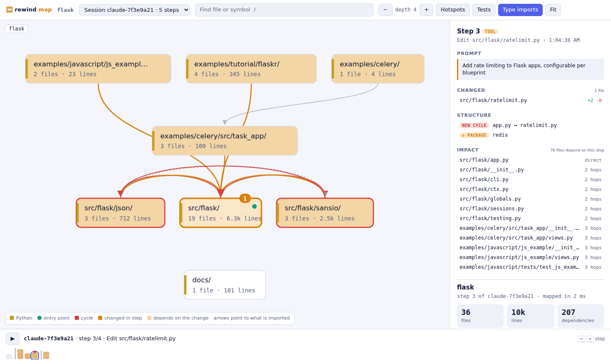
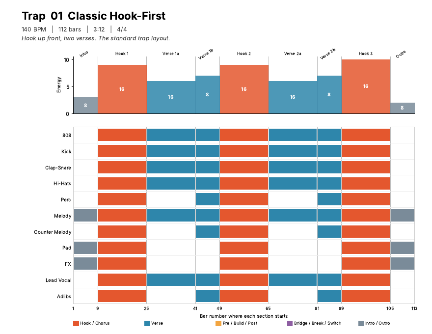
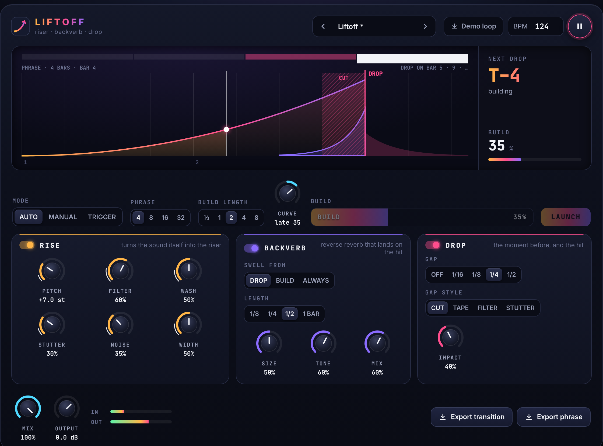

# cool_projects404

Things I build to sharpen my skills and make my own work easier.

| Project | What it is | Stack |
|---|---|---|
| [⏪ Rewind](rewind/) | Undo history and a code map for AI coding agents: every agent step saved as a Git snapshot you can restore, `rewind bisect` to find the step that broke the tests, an interactive map that replays what the agent changed, and an MCP server so agents can use it themselves | Go, Git internals, static analysis, MCP |
| [🍅 Tomato Dial](tomato-dial/) | A focus timer you set by dragging a kitchen-timer dial, with tasks, ambient sounds and stats | HTML, CSS, JS, Web Audio |
| [💿 Spin Room](spin-room/) | Eleven players (turntable, CD, cassette, jukebox and more) that spin to your beats and make the TikTok, Reels or YouTube video, with your tag, title and tags. Runs in the browser and as an AU/VST3 plugin that catches the beat as your DAW plays | HTML, CSS, JS, Web Audio, WebCodecs, C++, JUCE |
| [🎛️ Stencil](stencil/) | Arrangement stencils for Logic Pro and FL Studio: 20 MIDI song structures for trap, R&B, Afrobeats and rap, with visual maps. A drag-and-drop plugin is planned | MIDI, Python, JUCE (planned) |
| [🥁 Groove Rack](groove-rack/) | A drum and bass groove maker: channel rack, a piano roll on every channel with a chord lane, your own samples, MIDI in and out, 15 genre starters from Afrobeats and Amapiano to trap, drill and pop. Runs in the browser and as a VST3/AU plugin | HTML, CSS, JS, Web Audio, C++, JUCE |
| [🛫 Liftoff](liftoff/) | Record or load a sample, cut the part you want, and it becomes a riser: pitch, filter, stutter, wash, noise, a chorus, a tremolo on your grid, and a reverse swell landing on the end. Loops sync to your tempo; hear it in your song, then drag it into your DAW. Runs in the browser and as a VST3/AU plugin | HTML, CSS, JS, Web Audio, AudioWorklet, C++, JUCE |

## ⏪ Rewind — [`rewind/`](rewind/)

When an AI agent breaks something at step 14 of 30, `rewind restore 13` gets you back, without losing steps 1–12 or touching your branch. Each step is stored as a real Git commit under `refs/rewind/`, tagged with the prompt that caused it. Install the hooks with `rewind init claude` (or `codex`, `gemini`, `cursor`).

When the tests fail, `rewind bisect -- npm test` binary-searches the agent's steps and names the one that broke them, with its prompt and diff. `rewind undo <step>` then takes back just that step and keeps everything after it. Agents get the same powers through `rewind mcp`: they can query the code map, check what an edit can break, checkpoint, undo and bisect.

`rewind map` opens an interactive map of the codebase (12 languages: Go, Python, TypeScript/JavaScript, Java, Kotlin, C#, C/C++, Rust, PHP, Ruby, Dart) and replays the session on it: which code each step touched, what depends on it, and which step added a dependency or an import cycle. [Read more →](rewind/README.md)

## 🍅 Tomato Dial — [`tomato-dial/`](tomato-dial/index.html)

A focus timer that works like a real kitchen timer. Drag the dial to set the minutes, pick a task, and press Start.

**What it does**
- **Draggable dial timer** for Focus, Short break and Long break sessions, with a long break after every 4 tomatoes (you can change that)
- **Task list**: estimate each task in tomatoes. Each finished session adds one to the task you're working on, and the list shows how many hours of work are left
- **Background sound made in the browser** (no audio files): brown noise, rain, a fan, and an optional ticking clock
- **Bell and a shaking dial** when time is up, plus optional desktop notifications
- **Stats**: minutes and tomatoes today, your day streak, and a 14-day chart
- Keeps counting in a background tab and survives a page reload. Keeps the screen awake while running.
- Shortcuts: `Space` start/pause · `R` reset · `S` skip · `N` new task
- Light and dark themes, works on phones

**How to run it:** open `tomato-dial/index.html` in any browser. Nothing to install, no build step. Your data stays in your browser's localStorage and is never sent anywhere.

## 💿 Spin Room — [`spin-room/`](spin-room/index.html)

A 9:16 music showcase for TikTok. Load your beats, and a turntable or a portable CD player spins them: the tonearm drops and tracks across the record as the beat plays, the platter spins up and slows down like a real one, and the sound bars and background glow move with the bass.

**What it does**
- **Eleven players:** turntable, portable CD player, both together, a record on its own, a CD on its own, a cassette tape (the reels turn and the tape winds across as the beat plays), a pocket MP3 player (cover, title and live sound bars on its screen), a boombox (the speakers pump with the bass), a jukebox (neon arch, a record spinning behind the glass, your title on the selection card), a reel-to-reel tape machine (winding reels and moving VU needles) and a car stereo (your title scrolling on the display and a light ring that follows the bass)
- **Finds BPM and key by itself** when you add a beat (½ and ×2 buttons fix a tempo read at half or double speed)
- **Your tag on everything:** producer name, beat title, BPM, key, handle and tagline. Cover art prints on the record label and the CD, and can blur into the background. BPM and key in file names like `night_drive_140bpm_F#min.mp3` are used before detection
- **Three formats:** vertical 9:16 for TikTok, Reels and Shorts, widescreen 16:9 for YouTube, or square 1:1 for Instagram posts
- **Sells the beat:** your voice tag plays at the start (the beat dips under it), your logo can replace your name, a TikTok-style caption sits at the top, and an end card closes with "Lease this beat", your price and "Link in bio"
- **Finds the hook:** each beat starts at its most energetic part, a bar before the drop, and the drop gets a flash and a zoom
- **Remembers your beats** and voice tag in the browser, and saves your signature looks to switch in one tap
- **Motion:** slow zoom, bass shake or sway; rain, dust, a night window or color-shifting light behind the player; sound bars as bars, a wave, an LED meter or a ring around the player
- **Looks:** 6 vinyl colors, 5 rooms, any accent color, 3 title styles, 33⅓ or 45 RPM
- **Record video:** makes a 1080 × 1920, 1920 × 1080 or 1080 × 1080 MP4 (H.264 + AAC, a steady 30 fps) with the beat's sound: 15, 30 or 60 seconds, or the whole beat, from any start time. It fades out at the end and the tonearm lifts. Frames are drawn and encoded one by one with WebCodecs, so nothing is dropped even on a busy phone; browsers without it record live instead. Save it straight to your phone and upload it to TikTok, Reels or YouTube Shorts. Also makes a **beat pack** (several beats in one video, switching players) or **one video for every beat** at once
- **Full-screen mode** for screen recorders instead: hides the controls, counts down and plays. A guide shows where TikTok's buttons and caption will cover the video
- **Title, description and tags:** a YouTube title like `[FREE] Drake Type Beat - "Night Drive" | 140 BPM F# min`, a description with your buy link, a tag list and a TikTok caption with hashtags, each with a copy button
- Comes with a built-in demo beat made in the browser, so it works before you add anything

**How to use it:** open `spin-room/index.html` in a browser. Add beats, style it, pick a start time and length, then tap **Record** and keep the screen open while it records. Tap **Save video** when it's done. Beats stay on your device and are never uploaded.

**Install it as an app:** with GitHub Pages turned on for this repo (Settings → Pages → Deploy from a branch → the default branch, `/ (root)`), it lives at `https://8unionn-creator.github.io/cool_projects404/spin-room/`. Open that in Safari and choose Share → Add to Home Screen (on Android, Chrome → Install app). It then opens full screen with no browser bars, which keeps them out of your recordings, and works offline.

**Where the video goes:** **Save video** opens the share menu on iPhone (choose Save Video to put it in Photos) and downloads it elsewhere. Then in TikTok tap **+** → **Upload**.

**In your DAW: the Spin Room plugin** ([`spin-room-plugin/`](spin-room-plugin/)). An Audio Unit and VST3 for Mac, plus a standalone app. Put it in the last slot of your Master channel and play your beat: it catches the beat as it plays, with no export, trims it, and adds it to Spin Room with your DAW's exact BPM. Make the video right in the plugin window; it's saved to Movies → Spin Room. Your settings are saved with the DAW project. [Install and use it →](spin-room-plugin/INSTALL.md)

## 🎛️ Stencil — [`stencil/`](stencil/)

Song structures you drop into Logic Pro or FL Studio and fill with your own sounds. 20 MIDI stencils (five each for trap, R&B, Afrobeats and rap) carry the tempo, section markers and a placeholder for every instrument, and a PDF shows each one as a map with its energy curve. The plugin that will let you drag sections into the timeline is designed but not built yet. [Read more →](stencil/README.md)

## 🥁 Groove Rack — [`groove-rack/`](groove-rack/index.html)

A groove maker for drums and bass, built as the **GR-16**: a hardware-style machine with a glowing screen (genre, tempo, bar, swing and key), rubber step pads for every drum channel, an 808 lane, LED meters, a GENERATE key and knobs for swing and master. It runs in a browser and as a **VST3 / Audio Unit plugin** for any DAW.

**What it does**
- **Step pads:** tap a pad for on, ghost, off; drag across pads to paint, drag up or down on a hit for velocity, hold a hit for rolls (2, 3 or 4 hits in a step). Each channel can use 12, 16, 24 or 32 steps per bar, so triplet hats and 6/8 grooves work as well as straight 16ths. Loops are 4 or 8 bars, shown as one continuous lane with a mini map of every hit and a gliding playhead. Switch 4 ⇄ 8 with the loop bracket or the 4 | 8 switch (going to 8 repeats bars 1–4). Tapping a bar while it plays switches on the next bar line, so the groove never stumbles
- **Piano roll for every channel:** the whole loop on one screen, with bar numbers across the top, a chord lane, a keyboard, the notes and orange velocity stalks underneath (drag them to shape the dynamics). Open it with PIANO ROLL in the channel panel, the channel name, or P; zoom with FIT, 2× or 4×. On bass channels (808s, synth bass, log drums) tap to add a note, drag to lengthen it, drag a note to move it or its edge to resize it, hold for 808 slides; SCALE ONLY hides notes outside the key. On drum channels every hit sits at C4, the sound as it is: drag a hit up or down to pitch that one hit. Tap a chord to pick another from the key (triads and sevenths): the bass in that bar moves with it, and the dice and GENERATE follow the chords
- **808 lane:** tap to add a note and drag to lengthen it, tap a note to raise it a scale step. Tapping the key on the screen moves the bass and the chords to the next key
- **Groove generator:** the dice on every channel writes a new pattern in the style you pick, and GENERATE builds every channel together. Every genre has 2–3 styles with their own tempo range, patterns, feel, chords and bass (picking a style brings the tempo into its range):
  - **Bounce:** club bounce, Baltimore club, New Orleans bounce · **Afrobeats:** Afrobeats, Afropop, Afroswing · **Amapiano:** log drum, private school, Bacardi · **Afro House:** Afro house, Afro tech, Gqom
  - **Trap:** Atlanta, rage, melodic · **Drill:** UK, NY, Chicago · **Pop:** pop, dance pop, midtempo · **House:** deep, tech, UK garage · **Reggaeton:** dembow, perreo, moombahton
  - **Dancehall:** dancehall, one drop, soca · **Boom Bap:** 90s, jazzy, hardcore · **R&B:** modern, neo soul, new jack swing · **Lo-fi:** chillhop, jazzhop, lo-fi house · **Jersey Club:** Jersey club, Jersey drill · **Drum & Bass:** rollers, liquid, jungle
  - **Feel:** each part sits where the style puts it, a few milliseconds ahead of or behind the grid, with its own accents: Afrobeats shakers push ahead and congas sit back, boom bap and lo-fi snares drag, house hats lean on the off-beat, trap stays dead on the grid. Every note's timing can be changed in its note sheet, and the piano roll shows it
  - **Chords and bass:** each style has its own progressions (pop I–V–vi–IV, Amapiano and R&B sevenths, dark minor drill moves, ii–V in lo-fi and boom bap) and bass phrases (sliding drill 808s, log drum octave jumps, dembow, house octaves, walking bass, reese). Pick your own chords in the piano roll and GENERATE keeps them
  - **Phrases:** a loop plays as a phrase, with the main idea, a variation in bar 3 and a fill at the end (an 8 bar loop gets a small fill at bar 4 and a big one at bar 8)
  - **Teach it:** load drum or bass MIDI loops into a style and it learns how often each part hits on each step, then mixes that with its own patterns. 👍 LIKE learns the groove you have and picks its patterns more often; 👎 SKIP makes a new one and picks those less. What it learns stays in the browser and is saved with the project
  - **Genre rule tests** (`groove-rack/tests/genre-rules.js`) generate every style hundreds of times and check what makes each genre recognisable: the dembow, four on the floor, half-time snares, the Jersey kick, bass in key on the chord's root, phrases that repeat
- **15 genre starters**, each a full drums-and-bass groove: Bounce, Afrobeats, Amapiano, Afro House, Trap, Drill, Pop, House, Reggaeton, Dancehall, Boom Bap, R&B, Lo-fi, Jersey Club and Drum & Bass
- **Built-in sounds:** kicks, snares, claps, snaps, rims, hats, open hats, cymbals, toms, shakers, congas and talking drum, agogo and cowbell, woodblocks, 808s, bass, log drums and FX hits (squeak, reload, shot, air horn, scratch and more)
- **Channel panel:** tap a channel to open it below the pads: its sound on a screen with a waveform, ◀ ▶ to flip built-in sounds, load your own sample (or drop a file on the channel), knobs for volume, pan, pitch, length, tone, reverb and echo, and steps per bar, mute, solo and a new pattern
- **MIDI:** drag the loop out with the DRAG MIDI pad, import a MIDI file into the whole kit or one channel, export one channel. In the plugin, the pattern plays out as MIDI and DAW notes play the channels
- **Mixer:** volume, pan, pitch, length, tone, reverb and echo per track, mute and solo, hi-hats that choke each other
- **Export:** WAV (the loop ×1, ×2 or ×4, tails wrapped so it loops cleanly), WAV stems, MIDI
- Undo and redo, saved projects, project files and share links
- Shortcuts: `Space` play/stop · `←` `→` bar · `↑` `↓` channel · `R` new pattern · `Shift R` new groove · `M` mute · `S` solo · `Ctrl Z` undo

**In the browser:** open `groove-rack/index.html`. Nothing to install.

**As a plugin:** download the zip for your computer from the [releases](https://github.com/8unionn-creator/cool_projects404/releases) (or from the latest *groove rack plugin* run under Actions) and follow `INSTALL.md` inside. The plugin uses the same interface, plays a sampled version of the same kit locked to your DAW's tempo and timeline, and saves everything in your session. [Build it yourself →](groove-rack/plugin/README.md)

## 🛫 Liftoff — [`liftoff/`](liftoff/index.html)

Record or load a sample, cut the part you want, and Liftoff turns it into a riser you can drag straight into your session.

- **Get a sample:** press REC (the browser records your mic; the plugin records the audio coming down its own track), load a file, drop one anywhere, or try a demo. Recordings are trimmed to the sound
- **Cut it:** the SOURCE lane shows your whole sample with its beats. Drag across it to choose the part to use (it snaps to the beats), fine-tune the edges, and play just that part
- **In time:** a loop's tempo is read from its name or heard, and SYNC stretches it to your session's tempo without changing its pitch
- **Rise:** your sound pitches up (to +24 semitones, cleanly; SNAP keeps the top note in key), a resonant high-pass sweeps up, a gate speeds up from 1/4 to 1/32 notes, it washes into reverb and widens, with a white-noise riser underneath. A one-shot (a snare, a chop) becomes a roll
- **Tremolo and chorus:** a tremolo locked to your grid (1/4 to 1/32 notes and triplets; sine, square, ramp or auto-pan) and a wide stereo chorus
- **Backverb:** a reverse reverb that lands on time. In END mode it swells from your sound's first hit into the end of the riser, right where your drop goes
- **The screen:** the riser's real waveform, warming from dark to bright gold, with the END line, the swell, a playhead and a LIFTOFF IN T-minus countdown; click anywhere to play from there
- **Try things:** VARY plays four takes on your settings, A/B compares two, everything can be undone, REV turns the riser into a downlifter, and you can save your own presets next to the 10 factory ones
- **Out:** PREVIEW (through your DAW in the plugin), or IN SONG: it plays along with your DAW and ends on your drop bar. Then drag the clip from the plugin's strip onto a track, drag it out of the browser, or export a 24-bit WAV (NORM peaks it at -1 dBFS). The plugin also has a LIVE mode that builds into every drop as an insert effect

**In the browser:** open `liftoff/index.html`. **As a plugin:** download the installer from the [releases](https://github.com/8unionn-creator/cool_projects404/releases). [Read more →](liftoff/README.md)

