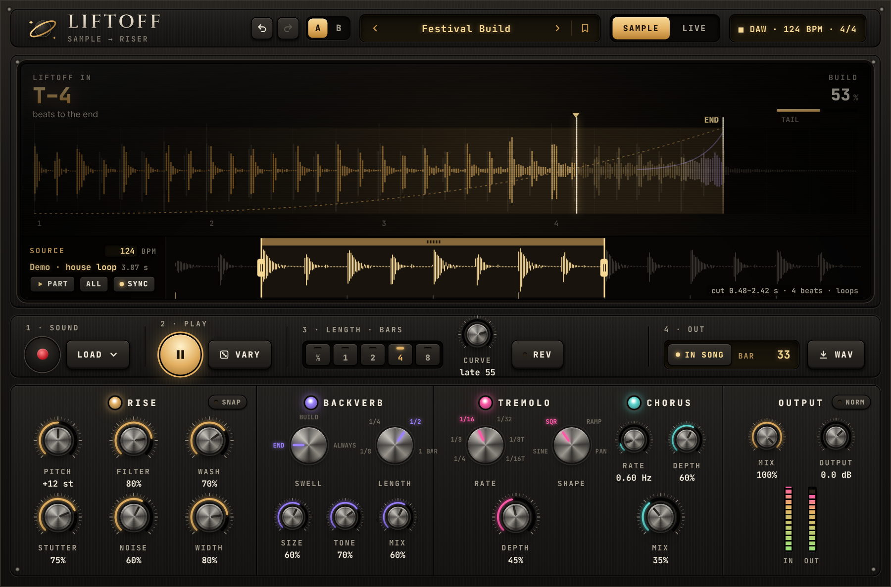

# 🛫 Liftoff

**Record or load a sample, cut the part you want, and Liftoff turns it into a riser.** Your sound pitches up, thins out, stutters, washes out and widens, with a noise riser on top, a chorus to thicken it and a tremolo pulsing on your grid. A one-shot (a snare, a chop) is retriggered faster and faster into a roll. A reverse swell made from the sound's own first hit rises into the end of the riser, right where your drop goes. Preview it, then drag it into your DAW or export the WAV.

Loops are stretched to your tempo and cuts snap to their beats. **REV** turns the riser into a downlifter, **VARY** plays you four takes on your settings, **A/B** compares two, everything can be undone, and you can save your own presets. In the plugin, **IN SONG** plays the riser along with your DAW so it ends on your drop bar.

It runs in the browser (open `index.html`) and as a **VST3 / Audio Unit** plugin, with the same interface in both. The plugin also has a **LIVE** mode: an insert effect that builds into every drop on your DAW's bars.



## How it works

Liftoff is laid out like a piece of hardware: one panel, read top to bottom in the order the sound flows. A header bar holds the preset display and the tempo. The glass screen shows the riser, with the source you cut from built into its bottom strip. The transport runs the whole job in four steps, left to right. The control panel has five sections: RISE, BACKVERB, TREMOLO, CHORUS and OUTPUT. In the plugin the window is that unit at 1200 × 791 and it scales with the window; in a browser on a phone the sections stack.

1. **Sound.** Press **REC**. The browser records your microphone; the plugin records the audio coming down its own track, so play your loop, vocal or synth in the DAW and press REC again to stop. Recordings are trimmed to the sound. Or press **LOAD** to open a file or a demo (a house loop, a snare that becomes a roll, a chord stab), or drop a file anywhere. As soon as it's in, the riser renders and plays.
2. **Play.** The big gold button (or Space) plays the riser; in the plugin it plays through the plugin's output, so you hear it through your DAW. Click anywhere on the screen to play from there. In the **SOURCE** strip, drag across your sound to cut the part to use (the cut snaps to its beats; hold Shift to cut freely), drag its edges to fine-tune, drag the bar on top to move it, and double-click for all of it. **PART** (or `A`) plays just that part. **VARY** (or `V`) renders four takes on your settings: click one to hear it, **USE** to keep it.
3. **Length.** Pick how many bars the riser lasts (½ to 8) and its **CURVE**, then shape it on the panel or pick a preset. **REV** plays the whole thing backwards: a downlifter that starts with a one-beat swell into the drop and falls away from it. Every change re-renders in the background.
4. **Out.** In the plugin, drag the riser from the tray under the window straight onto a track. It shows the waveform as soon as it's rendered. Turn on **IN SONG** and type the bar your drop is on: when your DAW plays, Liftoff plays the riser with it, ending exactly on that bar, so you hear it in the song before you drag it in. In the browser, drag **DRAG** into a DAW, a folder or the desktop (Chrome, Edge), or press **WAV** for a 24-bit WAV.

## Tempo

Liftoff works out a loop's tempo when it comes in (from a BPM in its file name, like `vox_140bpm.wav`, or by listening for its beats) and shows it next to **SOURCE**; type another to correct it. With **SYNC** on, the part you cut is time-stretched to the session's tempo without changing its pitch, so a 140 BPM loop sits on the bars of a 124 BPM song. Half and double time count as the same groove, so a loop is never stretched by more than a third. The loop's beats are marked along the bottom of the SOURCE strip, and cuts snap to them. One-shots are not stretched: they roll on the grid.

## Presets, undo, A/B

The preset display holds the 10 factory presets and your own. The bookmark button next to it saves the current sound (**Save as new…**, then type a name and press Enter), and saves over, renames or deletes one of yours. In the plugin your presets are kept in Liftoff's folder, so every session sees them. Every change can be undone with the arrows in the header or `Ctrl/Cmd+Z` (`Ctrl/Cmd+Shift+Z` redoes). **A** and **B** are two settings to compare: B starts as a copy of A, the lit letter is the one you are changing, and switching plays the other.

## The screen

The screen shows the riser's real waveform. It warms from dark to bright gold as it rises, its last beat turns violet where the reverse swell comes in, the **END** line marks where your drop goes, and the effects' tail fades out after it. The part of the sample you cut is a faint ghost behind it, the build curve runs through it like an automation lane, and the swell's shape is drawn on top. While it plays, the part already heard lights up, a playhead sweeps across, and the countdown reads LIFTOFF IN T–2 BARS, T–3… then LIFTOFF. In LIVE mode the screen follows your DAW's bars instead.

## The modules

- **RISE:** pitch up to +24 semitones (a grain shifter that splices where the waveform matches, so big jumps stay clean; **SNAP** keeps it to 4ths, 5ths and octaves, so the top note stays in key), a high-pass sweep with rising resonance, a gate that speeds up from 1/4 to 1/32 notes, a reverb wash the sound dissolves into, stereo width, and a white-noise riser. One **CURVE** shapes the whole build: late (a slow start that rushes at the end) or early (it jumps up, then hangs).
- **BACKVERB:** a reverse reverb that lands on time; its **SWELL** and **LENGTH** are stepped switches. Normally that means bouncing audio, reversing it and lining it up by hand; Liftoff convolves the sound with a time-reversed reverb and pulls it back by the reverb's length. **END** swells from your sample's first hit into the end of the riser, **BUILD** puts reverse swells on everything, growing with the build, and **ALWAYS** puts them on every sound.
- **TREMOLO:** volume pulses locked to the grid, set with two stepped switches (**RATE** and **SHAPE**): 1/4 to 1/32 notes, and 1/8 and 1/16 triplets. Shapes: **SINE**, **SQUARE** (hard chops), **RAMP** (pumping) or **PAN** (left and right take turns). **DEPTH** sets how deep.
- **CHORUS:** two modulated voices per side for width and thickness, with **RATE**, **DEPTH** and **MIX**.
- **OUTPUT:** **MIX** and **OUTPUT**, with meters. **NORM** normalizes every render to peak at -1 dBFS.

## Presets

Liftoff · Festival Build · Trap Lift · Vocal Backverb · Afro Swell · Chorus Bloom · Washout · Stutter Riser · Reverse Into The 1 · Subtle Lift. Presets set the sound. Your timing (mode, phrase), MIX and OUTPUT stay as they are.

## In the browser

Open `liftoff/index.html`. Nothing to install. It opens with the demo loop, or with the last sample you used (kept in your browser). Set the **BPM** to your session's tempo so the bars line up; until you do, it follows the first loop you load. Your settings, presets and samples stay in your browser and are never uploaded.

Shortcuts: `Space` play · `V` vary · `R` record · `A` play the part you cut · `←` `→` presets · `Ctrl/Cmd+Z` undo, `Ctrl/Cmd+Shift+Z` redo · `Esc` closes VARY. On knobs: drag up/down (`Shift` for fine), scroll, arrow keys, double-click to reset. On stepped switches: click a position, drag, scroll or use the arrows.

## As a plugin

Download the installer for your computer from the [releases](https://github.com/8unionn-creator/cool_projects404/releases) and follow [`plugin/INSTALL.md`](plugin/INSTALL.md). Put Liftoff on the track you want to sample. It opens in **SAMPLE** mode, passes that track through untouched, and takes the tempo from your DAW. The riser appears as a clip under the window: drag it onto a track. [Build it yourself →](plugin/README.md)

## Code

| File | |
|---|---|
| `dsp.js` | The DSP core, sample by sample: timeline, pitch shifter (one grain, spliced where the waveform matches), SVF filters, stutter gate, chorus, 8-line FDN wash, noise riser, tremolo, width, and the backverb send. Also makes the reversed reverb. |
| `transition.js` | The part of the sample you cut in, a riser out: lays it over the build (looped, or a one-shot as a roll), runs the core, adds the backverb (and the END swell) by FFT convolution, reverses and normalizes it, and writes WAVs. Also hears a loop's tempo and time-stretches it (WSOLA). |
| `params.js` | The 28 parameters and the factory presets. The plugin builds its DAW parameters from this same file. |
| `app.js`, `index.html` | The interface: the screen, the SOURCE lane, recording, loading, tempo and sync, preview, VARY, drag out, export, presets (yours too), undo and A/B, and the bridge to the plugin. |
| `plugin/Source/Core.cpp` | The same core in C++, for LIVE mode, plus the delay and JUCE's convolution. |
| `plugin/Source/PluginProcessor.cpp` | SAMPLE mode: records the track, plays the preview (or the part you cut) on top of it, plays the riser IN SONG with the DAW, and saves the sample's path with your session. The editor's clip strip drags the riser into the DAW. |

## Tests

```
node liftoff/tests/core-test.js         # the build, riser, pitch shifter, tremolo, chorus, backverb, timing modes (24 checks)
node liftoff/tests/transition-test.js   # a sample becomes a riser: loop, roll, END swell, tempo, time-stretch, REV, NORM (19 checks)
```

The plugin has two more, run by CI on Windows, macOS and Linux: `LiftoffEngineTest` (alignment of the swell with its hit, latency, block sizes, MIDI triggers, IN SONG landing on its bar) with `tests/parity.js` (the C++ engine and `dsp.js` produce the same samples), and `LiftoffHostTest`, which loads the built VST3 like a DAW (it opens in SAMPLE mode with no latency and passes the track through untouched). On macOS the Audio Unit also goes through `auval`.
