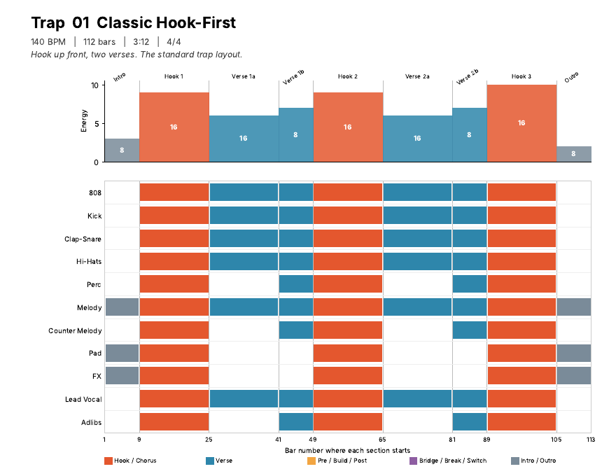

# 🎛️ Stencil

Arrangement stencils for Logic Pro and FL Studio: ready-made song structures you drop into a project and fill with your own sounds. Built because arranging is the part of beat-making I get stuck on.

**Status:** the stencil pack and the plugin UI design are done. The plugin itself is not built yet.

## What's here

- **`stencils/`**: 20 MIDI stencils, five each for Trap (140 BPM), R&B (80), Afrobeats (104) and Rap (90). Each file has the tempo, section markers, a guide track with one note per section, and one track per instrument with a silent placeholder note wherever that instrument plays.
- **`stencils/manifest.json`**: the same structures as JSON (sections, bar counts, energy level, which instruments play where).
- **`design/Arrangement_Maps.pdf`**: one visual map per stencil, with the energy curve and instrument lanes.
- **`design/ui-mockup.dc.html`**: the plugin window mockup (markup only; it was drawn in a design canvas and does not render fully on its own).
- **`tools/`**: the Python scripts that generate the MIDI files, manifest and PDF.
- **`CLAUDE.md`**: the build brief for the plugin.

Each genre has a classic form, a short streaming version (about 2:20) and three variations such as beat switch, slow burn, chorus-first, DJ edit and stripped breakdown. The structures are genre-standard layouts, not copies of specific songs.

## How to use the stencils

**Logic Pro:** new empty project, then File → Import → MIDI File (or drag the `.mid` to bar 1). Accept the tempo if asked.

**FL Studio:** File → Import → MIDI file, tick "Create one channel per track" and accept the tempo.

Replace the placeholder notes with your own parts. Bar counts and tempos are starting points.

Not tested yet: the imports in both DAWs. Markers may not come through in FL Studio; the guide track and the PDF give the bar numbers if they don't.

## Planned: the plugin

A JUCE plugin (AU for Logic Pro, VST3 for FL Studio) that browses the stencils by genre and lets you drag the full arrangement, one section, or one instrument lane straight into the DAW timeline.
